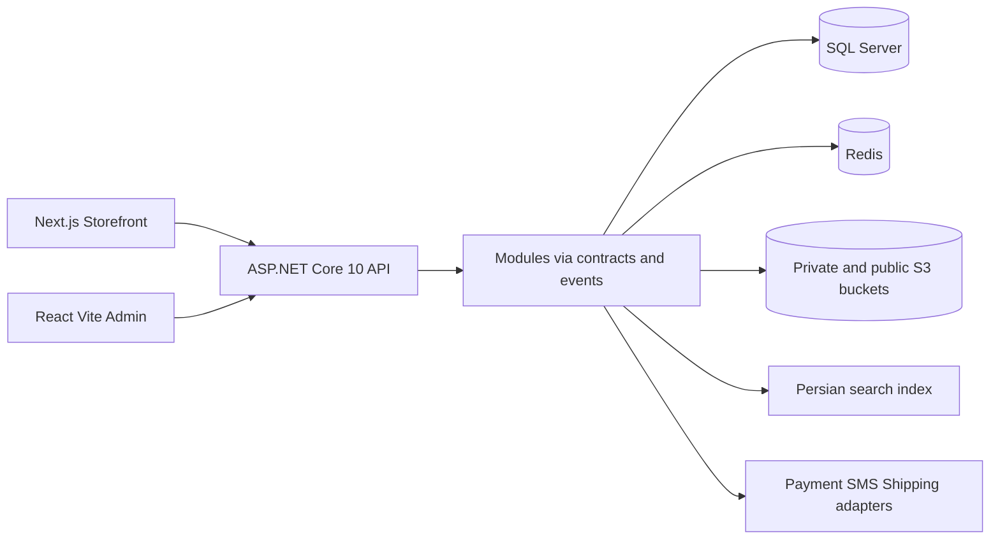
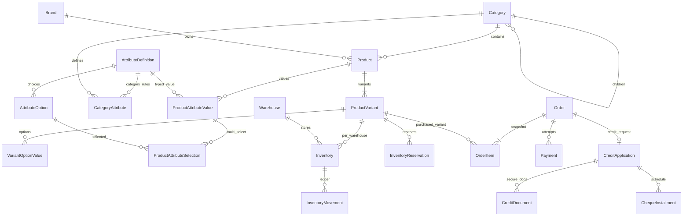

# معماری و قرارداد ادامهٔ پروژه

## وضعیت فعلی

فروشگاه Next.js هم preview صریح و هم API mode متصل به SQL دارد. روت فقط metadata و صفحات query/lookup محدود می‌خوانند. آخرین اعمال اصلی۱۷ migration هفت schema و seed محلی است؛۵۹ سناریوی SQL در اجرای قبلی موفق و چهار مورد تازه هنوز اجرا نشده‌اند؛ بعضی ماژول‌ها هنوز اسکلت‌اند. uploader عمومی Catalog، گالری و proxy تصویر آماده‌اند؛ پذیرش واقعی ClamAV/S3 و سیاست Ready بدون ارجاع باقی‌اند. سبد و نشست مشتری، quote و سیاست هزینهٔ سروری به رابط وصل‌اند؛ quote رابطه‌ای و snapshot چندماژولی Serializable در composition root هماهنگ می‌شود. رزرو داخلی Inventory آماده است؛ سفارش، اتصال رزرو checkout و پرداخت واقعی باقی‌اند. مرز دقیق در `CHECKOUT-QUOTES.md` است.

## معماری هدف

هر ماژول DbContext/schema و migration خود را دارد؛ دسترسی مستقیم به DbContext ماژول دیگر انجام نمی‌شود. گردش‌های چندماژولی باید از قرارداد و event پایدار استفاده کنند؛ outbox گردش سفارش هنوز پیاده نشده است. قرارداد خواندنی versioned موجودی اکنون view متعلق به Inventory است که Catalog آن را keyless می‌خواند (`CATALOG-QUERY.md`)؛ mutation از این مسیر وجود ندارد. idempotency دفتر اصلاح انبار پیاده شده و تست اصلاح تکراری/همزمان روی SQL واقعی پاس شده است. staging و production از هم جدا می‌مانند.

## ERD اولیهٔ هستهٔ کاتالوگ

این ERD نقشهٔ کامل هدف است؛ Catalog/Inventory/Identity/CMS/Payments/Credit/Sales migration دارند، اما جداول Orders و چند قابلیت نمودار هنوز پیاده نشده‌اند؛ Reservations داخلی Inventory اکنون پیاده شده است (`INVENTORY-RESERVATIONS.md`). پانزده migration فعلی با موفقیت روی SQL محلی اعمال شده‌اند. قواعدی مانند چرخهٔ دسته، گزینهٔ معتبر ویژگی، `Reserved <= OnHand`، سقف اعتبار و مجوز مدارک باید در مدل و تست تراکنشی اعمال شوند.

## قرارداد پول

API مبلغ را به شکل رشتهٔ رقم لاتین ریال می‌دهد: `"689000000"`. C# از `long` و SQL از `bigint` استفاده می‌کند. JavaScript قبل از محاسبه به bigint تبدیل می‌کند. نمایش تومان از تبدیل نمایشی جداست. calculator تومان با یک رقم اعشار (ریال دقیق) می‌گیرد؛ طرح واحد گردکردن ۱ یا ۱۰ ریال دارد و اختلاف در چک آخر جبران می‌شود؛ این یک فرض محاسبهٔ نمونه است و قانون تجاری تأییدشده نیست.

## فروش چکی قابل تنظیم از پنل

مدل هدف `CreditPlan` باید حداقل این داده‌ها را داشته باشد: نام، مدت، فاصلهٔ چک، تعداد چک، پیش‌پرداخت، روش/مبنای محاسبهٔ افزوده، نرخ، کف/سقف مبلغ، دسته‌های مجاز، مدارک موردنیاز، فعال بودن، بازهٔ اعتبار، نسخه و متن شرایط. پارامتر نرخ، روش گردکردن، مالیات و کارمزد بعد از دریافت قانون واقعی تثبیت می‌شوند. snapshot نسخهٔ طرح و رضایت کاربر در درخواست نگهداری می‌شود. تغییر طرح مدیر نباید تعهد سفارش قبلی را عوض کند.

گردش هدف: درخواست → دریافت امن مدارک با رضایت → بررسی مجاز → تأیید/رد → ثبت چک‌ها و پیش‌پرداخت → قطعی‌سازی کنترل‌شده → ردیابی وصول/برگشت و یادآوری. هیچ اتصال اعتبارسنجی یا انتقال پول بدون قرارداد مستند جعل نمی‌شود.

## مرز اتصال API پس از تأیید UI

1. تبدیل contractهای fixtures به DTO نسخه‌دار و repositoryهای async؛ UI مستقل از جزئیات EF می‌ماند.
2. واکشی عمومی صفحات از server components؛ query تعاملی با TanStack Query و cancellation.
3. جایگزینی storage سبد با سبد مهمان سرور و ادغام مجاز پس از OTP.
4. حذف ورود/پرداخت نمایشی و fail-closed نگه داشتن providerهای بدون تنظیم.
5. دریافت منو، برندینگ، بلوک‌های خانه و شرایط فروش از CMS؛ پنل مجوزدار با audit.
6. اعمال validator سرور و تست مجدد قیمت/موجودی در checkout؛ UI فقط خطا و نتیجهٔ معتبر را نمایش می‌دهد.
7. تست end-to-end واقعی، PWA بدون cache دادهٔ خصوصی، SEO تولید و سنجش عملکرد.

## محدودیت میزبان

محیط فعلی macOS ARM است. image SQL Server رسمی برای Linux x86-64 پشتیبانی می‌شود و اجرای emulation پشتیبانی تولیدی ندارد. SQL محلی با Rosetta سالم است و چهار سناریوی واقعی پاس شده‌اند؛ آزمون نهایی روی Linux x86-64 یا سرویس پشتیبانی‌شده جدا لازم است. شاهد محلی جای پشتیبانی تولید را نمی‌گیرد.

مرجع فنی: [Next.js installation](https://nextjs.org/docs/app/getting-started/installation)، [SQL Server containers](https://learn.microsoft.com/en-us/sql/linux/containers/deploy?view=sql-server-linux-ver15). راهنمای نسخهٔ نصب‌شدهٔ Next.js نیز هنگام پیاده‌سازی از `node_modules/next/dist/docs` بررسی شد.

## audit اتمیک درخواست‌های مدیریت

`AdminAuditFilter` در composition root، تغییر موفق مدیریت و AuditEvent را در یک transaction SQL با isolation برابر Serializable ثبت می‌کند. connection factory عادی هر ماژول مستقل باقی است؛ فقط contextهای همان درخواست فرمان، اتصال و transaction متعلق به Identity را با UseTransaction به اشتراک می‌گذارند. اتصال ماژول باید بسته و متعلق به همان server/database باشد. این هماهنگی اجازهٔ خواندن جدول ماژول دیگر از داخل ماژول‌ها نمی‌دهد و transaction توزیع‌شده ندارد.

Category.Save و Inventory.Adjust در صورت وجود Serializable آن را join می‌کنند و transaction والد را commit نمی‌کنند؛ فراخوانی مستقل همچنان transaction خودش را دارد. نتیجهٔ HTTP بعد از commit برمی‌گردد. exception، تعارض نسخه و نتیجهٔ خطا commit نمی‌شوند؛ GET/HEAD/OPTIONS رویداد موفقیت mutation نمی‌نویسند. پاسخ فرمان باید materialized باشد؛ streaming رسانه و auth/refresh بیرون این گروه‌اند. تصاویر عمومی trail مستقل Catalog خود را دارند.

شاهد برش audit:۱۰ سناریوی SQL واقعی پاس شدند؛ چهار مورد خطای درج audit را با CHECK موقت فقط در SaymanTest_* اعمال می‌کنند. برند، دسته و موجودی/ledger/rowversion rollback شدند؛ موفقیت عادی یک رویداد با عامل/مسیر/trace نوشت و stale version یا خواندن عمومی چیزی ننوشت. تست‌های قبلی همزمانی، CMS، MFA و رسانه نیز پاس ماندند. migration جدیدی لازم نبود.

Audit دامنه با دادهٔ قبل/بعد، رویداد امنیتی شکست‌ها، سیاست نگه‌داری و مدیریت کارکنان/بازیابی MFA هنوز باقی‌اند؛ این برش پایان کامل ID-02 نیست. مرجع API EF: [اشتراک connection و transaction](https://learn.microsoft.com/en-us/ef/core/saving/transactions#cross-context-transaction).

رزرو داخلی Inventory از قرارداد `IStockReservations` با owner/order/request معتبر سرور انجام می‌شود؛ root سفارش آینده باید اتصال/تراکنش را هماهنگ کند. انقضا و لغو فقط Reserved را آزاد می‌کنند، تخصیص تا ارسال حفظ می‌شود و خروج فیزیکی ledger یک‌بارمصرف دارد. مرز فنی، SQL و کارهای متصل‌نشده در [INVENTORY-RESERVATIONS.md](INVENTORY-RESERVATIONS.md) ثبت شده‌اند.

Sales اکنون مالک Carts/CartLines است؛ قیمت و موجودی cart فقط از قراردادهای خواندنی ماژول‌ها می‌آیند. ادغام مهمان/عضو و نوشتن نسخه‌دار تراکنش مستقل کوتاه دارند؛ سبد قیمت سفارش یا موجودی رزروشده را نگه نمی‌دارد. BFF خصوصی بدون cache، AuthProvider و ShopProvider متصل و QA SQL/مرورگر در [SERVER-CART.md](SERVER-CART.md) شرح داده شده‌اند.

سیاست هزینه در Sales متعلق به همان context سبد/quote است؛ query آن در تراکنش Serializable quote انجام و نسخه/قواعد در fingerprint و snapshot حفظ می‌شود. AdminAuditFilter فقط برای mutation مدیریتی context Sales را هم به تراکنش Identity متصل می‌کند. مالیات/ارسال بدون رکورد پیش‌فرض تعیین‌نشده‌اند. [CHECKOUT-CHARGES.md](CHECKOUT-CHARGES.md) قرارداد schema2 و سازگاری replay schema1 را شرح می‌دهد.

## هماهنگی سفارش موقت (سورس تازه)

Sales مالک تنظیم سفارش، header/line/event رابطه‌ای و snapshot است؛ Inventory همچنان مالک hold و دفتر موجودی می‌ماند. `SalesTransactionCoordinator` در composition root فقط برای فرمان جاری contextهای ماژول را به اتصال/Serializable Sales متصل می‌کند؛ worker لغو/انقضا فقط Sales و Inventory را enlist می‌کند. mutation مدیریت از تراکنش Identity/audit موجود استفاده می‌کند. قفل ثابت مالک، قفل سبد و قفل موجودی در همین مرز رعایت می‌شوند. خواندن و migrationها context مستقل دارند.

quote3 نسخهٔ قیمت و eligibility سفارش موقت را حمل می‌کند؛ ایجاد سفارش مالک/مهلت/نسخه/fingerprint/موجودی را دوباره می‌سنجد، سپس hold و سفارش و مصرف سبد را با هم ثبت می‌کند. idempotency پایدار و unique quote، replay بدون تمدید مهلت، لغو/انقضای قابل تکرار و عدم کاهش OnHand پیش از ارسال حفظ می‌شوند. مرورگر فقط contact/address/UUID می‌فرستد. payment readiness همیشه بسته است تا provider واقعی تکمیل شود. قرارداد، شواهد و پذیرش‌های باز در [TEMPORARY-ORDERS.md](TEMPORARY-ORDERS.md)؛ این بخش هنوز در runtime اصلی deploy نشده است.

پنل صفحات عملیاتی را با lazy/Suspense بارگیری می‌کند؛ primitiveهای UI از جدول TanStack و helperهای فرم از Catalog جدا شدند تا ورود به کد همهٔ فرم‌ها وابسته نباشد. entry build ایزوله۵۱۳٫۱۰→۴۰۲٫۰۱kB و بدون تغییر threshold شد؛ `ADMIN-PERFORMANCE.md` شواهد و پذیرش‌های باز احرازشده را ثبت می‌کند.

projection آفلاین Catalog بدون Include/graph از ستون‌های عمومی و EXISTS تنوع فعال استفاده می‌کند؛ composition root فقط site عمومی CMS را به آن می‌افزاید. Native DTO no-store و Next پس از strict validation آن را با marker مجاز PWA می‌دهد. هیچ وابستگی runtime به خواندن Inventory/Purchasing در این مسیر نیست؛ SQLهای مثبت و plan هنوز پذیرفته نشده‌اند. مرجع OFFLINE-PROJECTION است.

سایت‌مپ هم قرارداد مستقل Catalog برای count و صفحهٔ حداکثر۱۰۰۰ key/پرچم زبان دارد؛ composition root اجازهٔ SEO هر زبان را از CMS اضافه می‌کند. Next فقط manifest/page strict را می‌خواند و فایل‌های XML ریشه را با rewrite داخلی سرو می‌کند؛ robots دیگر snapshot کامل نمی‌خواند. زبان واقعی، گیت محیط/preview و سقف مجموع۵۰٬۰۰۰ فایل حفظ می‌شوند. snapshot تراکنشی مشترک شمارش/صفحه و plan بار OFFSET هنوز پذیرفته نشده‌اند؛ [SITEMAP-PROJECTION.md](SITEMAP-PROJECTION.md).

Inventory تاریخچهٔ فیزیکی را از IStockMovementHistory، بدون graph یا tracking و با فیلتر/seek/TOP51 ارائه می‌کند؛ composition root آن را فقط با inventory.read کامل نگاشت می‌کند. پنل صفحهٔ۵۰تایی strict را جدا از snapshot موجودی می‌گیرد؛ includeMovements=false از query تکراری تاریخچه جلوگیری می‌کند. ذخیره/رزرو/adjust تغییر نکرده، schema تازه ندارد و مدل بدون تغییر است؛ snapshot صفحه‌ها و plan واقعی هنوز پذیرفته نشده‌اند. [INVENTORY-HISTORY.md](INVENTORY-HISTORY.md).

در برش بعد، AdminStockService در composition root از IAdminStockCatalog صفحه/lookup متادیتای تنوع و از IAdminStockReader موجودی فقط همان شناسه‌ها را می‌گیرد؛ هیچ context مشترک برای خواندن یا دسترسی ماژول به context دیگری وجود ندارد. نبود Stock برای تنوع موجود صفر/version=null است، نبود Catalog404 و خطای خواندن بدون fallback است. داشبورد شمارنده‌های مستقل دارد؛ صفحهٔ موجودی و داشبورد graph کامل را درخواست نمی‌کنند، ولی سایر صفحات هنوز تکمیل pagination می‌خواهند. مرجع [INVENTORY-PAGING.md](INVENTORY-PAGING.md) است؛ Stock/metadata snapshot تراکنشی مشترک ندارند و mutation همچنان به کنترل نسخه/تراکنش قبلی متکی است.

IAdminProducts مالک query خلاصهٔ۵۰/lookup۲۴ و graph کاملِ همان یک کالا در Catalog است؛ CatalogProductGraph زنجیرهٔ Include قبلی را برای خواندن عمومی/قدیمی و جزئیات مشترک می‌کند. metadataOnly خواندن graph محصولات را حذف می‌کند؛ فرم‌های پنل از همین metadata و جزئیات تازه، و CMS از picker خلاصه استفاده می‌کنند. قراردادهای GET بدون coordinator mutation/audit هستند و schema تغییر نکرد. nullهای لازم برای wire در DTOها صریح‌اند و تست serializer واقعی با parser TypeScript وجود دارد. [ADMIN-PRODUCTS.md](ADMIN-PRODUCTS.md) scope و پذیرش‌های باز را ثبت می‌کند.

## انتقال اتمیک MFA و مجوز ثبت دوباره

Identity مالک MfaRecoveryCodes و MfaRecoveryPending است؛ تولید/مصرف کد و setup/verify قفل/تراکنش همان user، reload پس از middleware و بررسی دوبارهٔ stamp دارند. code خام صرفاً پاسخ یک‌باره است؛ SHA-256 وابسته به حساب از کد۱۲۸بیتی تصادفی ذخیره می‌شود. بازیابی همهٔ sessionهای قدیمی را revoke و grant محدود بدون role/permission/refresh می‌دهد. وضعیت ماندگار مانع enrollment با رمز صرف می‌شود و setup deadline را افزایش نمی‌دهد. تکمیل کلید تازه، پرچم و کدهای قدیمی را پاک و نشست کامل را commit می‌کند؛ هیچ DbContext ماژول دیگری درگیر نیست.

Reset شمارندهٔ شکست قبل از عامل دوم و تغییر دوبارهٔ stamp تازه با refresh منسوخ اصلاح شدند. schema۱۹ آماده ولی روی اصلی اعمال نشده است؛ SQL/MFA/backup مثبت هنوز پذیرفته نشده‌اند. [MFA-RECOVERY.md](MFA-RECOVERY.md) مرجع قرارداد، آزمون‌ها و مرزهای دستی است.

## کنترل دسترسی کارکنان در Identity

StaffAdministration فقط User/Role/Session/Audit متعلق به Identity را از قرارداد IStaffAdministration مدیریت می‌کند. metadata خواندنی۵۰ حساب و سپس نقش همان شناسه‌هاست؛ hash/stamp امنیتی/token/graph وارد DTO نمی‌شود. افزودن از حساب موجودِ فعال با تماس تأییدشده و رمز، MFA را اجباری می‌کند؛ بدون جعل تأیید تماس یا ساخت credential.

فرمان زیر transaction audit اصلی، ردیف Administrator و actor/target را قفل و actor/stamp/نسخه را تازه بررسی می‌کند. منع تغییر خود و کنترل مدیر فعال با سری‌سازی عضویت، از حذف همزمان آخرین دسترسی مدیر جلوگیری می‌کند. تغییر role/active/stamp/ابطال نشست و رویدادهای delta هدف، با audit اصلی یک commit دارند؛ خطای audit همه را rollback می‌کند. schema موجود کافی و اصلی همچنان۱۷/سورس۱۹ است. [STAFF-ADMINISTRATION.md](STAFF-ADMINISTRATION.md) شواهد و رقابت‌های SQL اجرا‌نشده را نگه می‌دارد.
